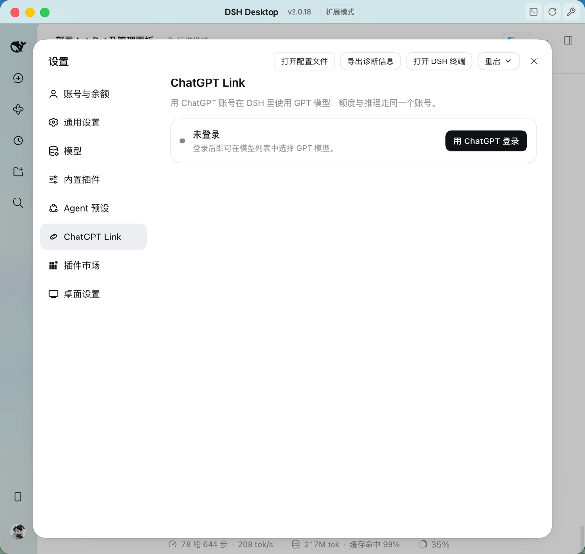
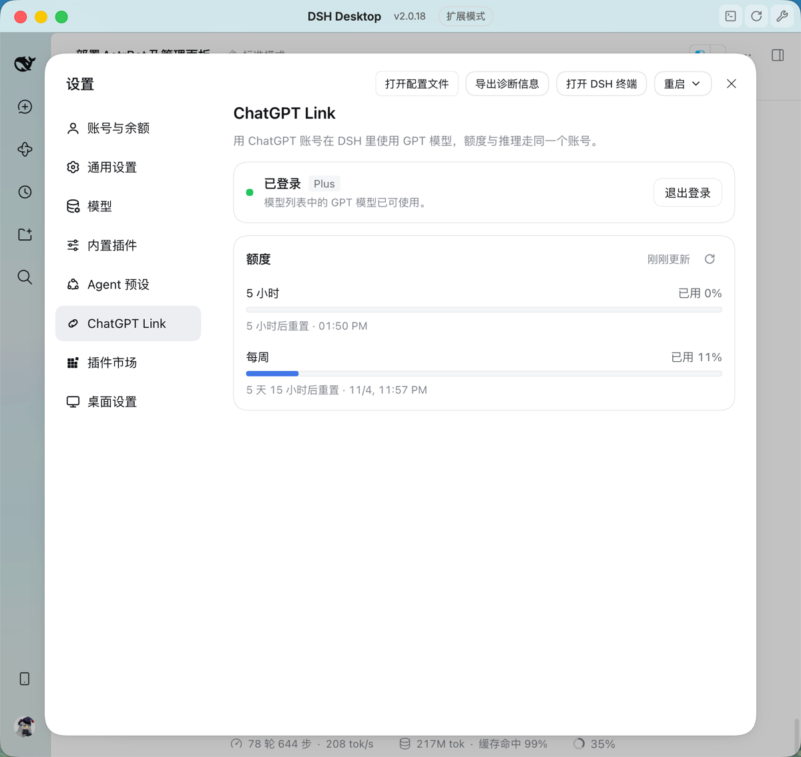
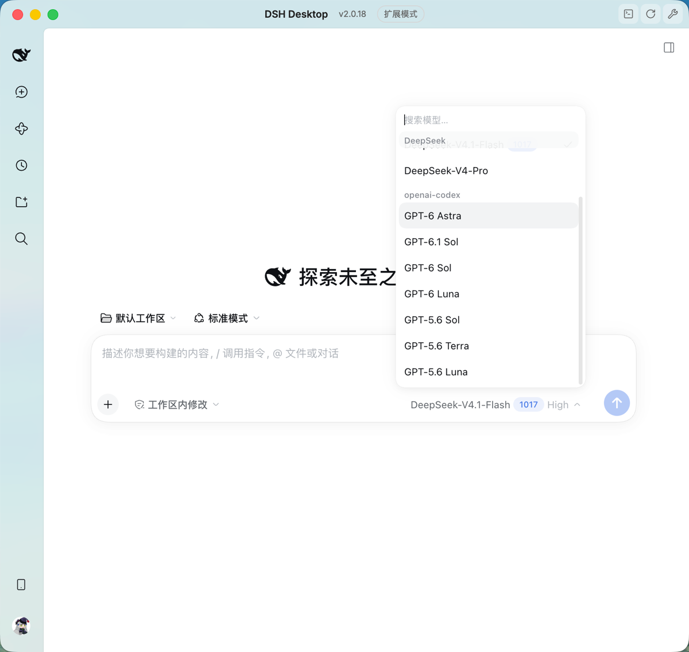
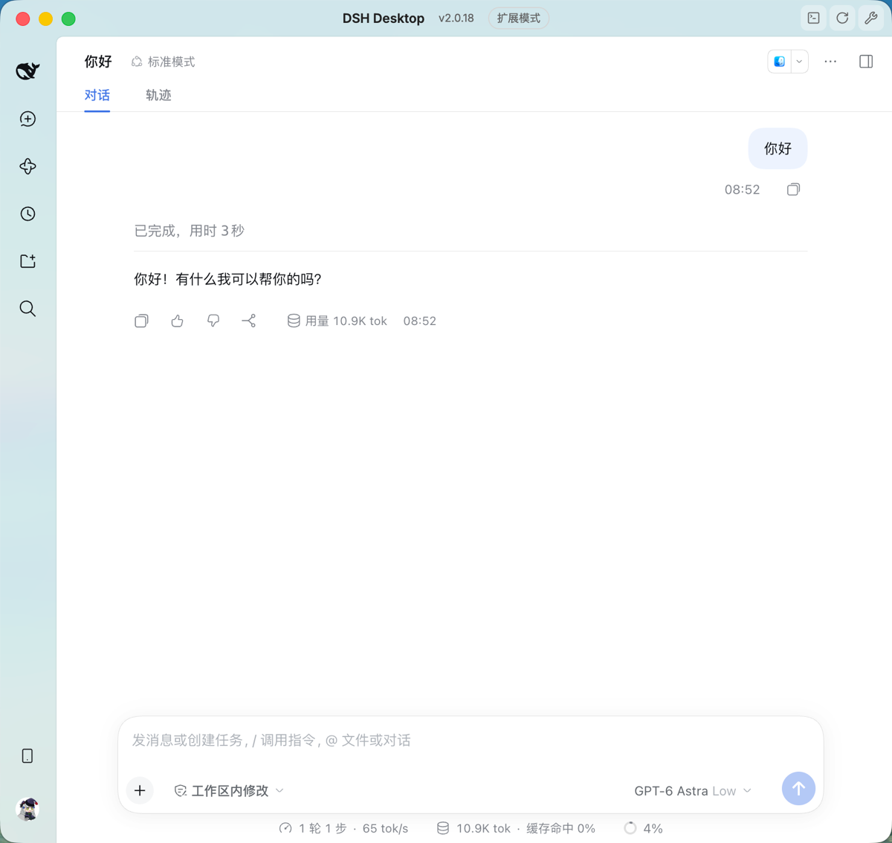

<p align="center">
  
</p>

<h1 align="center">ChatGPT Link</h1>

<p align="center">包名 <code>dsh-gpt-link</code> · 版本 <code>0.2.0</code> · DeepSeek Harness 插件</p>

## 概述

安装后，可以用自己的 ChatGPT 账号（Plus、Pro 等订阅）登录，在 DSH 的模型选择器里使用 GPT 模型，并在设置页查看这个账号的额度用量。除 DSH Desktop 外不需要安装其他软件，不依赖 ChatGPT 桌面应用或 Codex 命令行。

模型、推理协议与 OAuth 登录由 DSH 自带的 `@deepseek-ai/dsh-llm-pi-ai` 提供。本插件为它的 `openai-codex` 路由补上设置页缺少的登录入口，并读取同一份登录显示额度，因此额度一定属于正在跑推理的那个账号。插件本身不注册模型提供方，也不保存令牌：令牌由 pi-ai 写入 DSH 凭据库并负责刷新。

安装后可以使用：

- **登录**：设置 → ChatGPT Link → 用 ChatGPT 登录。系统浏览器会自动打开授权页，授权完成后回到 DSH 即可。浏览器没有自动返回时，可以把地址栏中的完整地址粘贴回设置页。
- **退出**：设置 → ChatGPT Link → 退出登录。除删除本机登录外，还会结束 OpenAI 上的这次会话，ChatGPT「活动会话」里不会留下多余的设备。
- **模型**：在模型选择器里选择 GPT 模型，依次为 GPT-6 Astra、GPT-6.1 Sol、GPT-6 Sol、GPT-6 Luna、GPT-5.6 Sol、GPT-5.6 Terra、GPT-5.6 Luna。所有模型统一提供 Low、Medium、High、Xhigh 四档推理等级，默认 Low。未登录时这些模型不会出现在选择器里，登录后自动出现。
- **额度**：设置 → ChatGPT Link 显示 5 小时窗口和每周窗口的已用百分比、进度条与重置时间，用到 90% 以上会标红，额度用尽时会标出。

## 截图

| 未登录 | 已登录，显示额度 |
|---|---|
|  |  |
| **模型选择器** | **用 GPT 模型对话** |
|  |  |

## 安装

需要 macOS 上的 DSH Desktop，内置 `@deepseek-ai/dsh` 版本为 `>=0.2.1-rc.2 <0.3.0`。

### 从插件市场安装

在 DSH 的插件市场搜索 **dsh-gpt-link** 或 **ChatGPT Link**，点安装，重启 DSH Desktop。

### 用命令安装

请使用 DSH Desktop 自带的 `dsh` 与 `pnpm` 命令，系统 PATH 上的其他版本 pnpm 可能报 `ERR_PNPM_UNEXPECTED_STORE`：

```sh
CLI_BIN=$(ls -dt "$HOME/Library/Application Support/DSH Desktop/cli/"*/bin | head -1)
export PATH="$CLI_BIN:$PATH"
```

从 npm 安装到 profile（以 Desktop 默认的 `web` 为例）：

```sh
dsh plugin --profile web add dsh-gpt-link
```

重启 DSH Desktop，在设置中打开 **ChatGPT Link** 完成登录。

### 从源码安装

需要修改插件时使用：

```sh
git clone https://github.com/Clukay-Fun/dsh-gpt-link.git
cd dsh-gpt-link
pnpm install
pnpm run build
dsh plugin --profile web add "$(pwd)"
```

路径需为绝对路径。重启 DSH Desktop 后生效。

### 确认配置已生效

```sh
dsh --profile web --dump-config | grep -A 4 "openai-codex:"
```

输出应类似：

```yaml
      openai-codex:
        reasoning: low
        models:
          - id: gpt-6-astra
            reasoningEfforts:
```

### 模型没有出现时

插件会为 `llm-pi-ai` 写入 `providers.openai-codex` 配置。如果 profile 自己的 `~/.dsh/profiles/web/cordis.patch.yml` 中已有 `llm-pi-ai` 的 `providers` 设置（例如在「设置 → 模型」里改过提供方），它会整体覆盖插件的配置。删除该文件中的 `llm-pi-ai` 段，重启 DSH Desktop，再按上一节确认。

### 更新

从插件市场安装的，在市场里点更新。从 npm 安装的：

```sh
dsh plugin --profile web update dsh-gpt-link
```

从源码安装的，拉取并重新构建即可，无需重新添加：

```sh
git pull
pnpm install
pnpm run build
```

然后重启 DSH Desktop。

### OpenAI 推出新模型时

模型列表写在插件的 `cordis.patch.yml` 里，模型的接口地址和上下文长度则来自 DSH Desktop 自带的 pi-ai 模型目录。新模型要出现在选择器里，两边都要更新：先等 DSH Desktop 更新到目录里有这个模型的版本，再等插件发布加入它的新版本，然后在插件市场点更新。

### 卸载

```sh
dsh plugin --profile web remove dsh-gpt-link
```

卸载插件不会删除 pi-ai 保存的登录。如需退出登录，请在卸载前到设置 → ChatGPT Link 点击「退出登录」。

## 目录结构

| 路径 | 内容 |
|---|---|
| `index.js` | 后端入口：登录与额度接口 |
| `client/index.js` | 设置页前端 |
| `src/` | 后端源码（TypeScript），构建到 `lib/` |
| `cordis.patch.yml` | `openai-codex` 路由、模型列表与推理等级 |
| `assets/icon.svg` | 插件图标 |
| `docs/screenshots/` | README 中的截图，不随 npm 包发布 |
| `locale/` | 插件名称与简介的中英文 |
| `scripts/check-contract.mjs` | 核对已安装的 pi-ai 是否仍符合插件依赖的约定 |
| `test/` | 测试，`pnpm test` 运行 |
| `.github/workflows/publish.yml` | 推送版本标签时自动发布到 npm |

## 发布新版本

1. 修改 `package.json` 的版本号和 README 顶部的版本，运行 `pnpm run build`，把 `lib/` 一并提交。
2. 合并到 `main` 后打标签并推送，例如 `git tag v0.2.1 && git push origin v0.2.1`。
3. GitHub Actions 会核对标签与版本号一致、重新构建并运行测试，然后通过 npm Trusted Publishing 发布，不需要令牌或验证码。

加入新模型时，在 `cordis.patch.yml` 的 `models` 里按选择器顺序加一行，同步更新上文「模型」一段，再在装有新版 DSH Desktop 的机器上运行 `pnpm test`：`scripts/check-contract.mjs` 会核对本机的模型目录里确实有这个 id。
